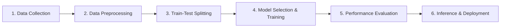

> **Materi:** *"Introduction to Machine Learning"*  
> **Narasumber:** Dr. Taniza Tajuddin (Universiti Teknologi MARA / UiTM Kedah, Malaysia)  
> **Penyelenggara:** Informatics Practitioner Lecture Series Program Studi Informatika, Universitas Bengkulu  
> **Tautan Video Webinar:** [YouTube Live - Informatics Practitioner Lecture Series](https://www.youtube.com/live/0LFeuSypYro?si=IdR1VDoQNQS1XyYk)

---

## 📌 Ringkasan Studi Kasus

Pengolahan data skala besar pada industri keuangan memerlukan transisi dari sistem aturan manual (*rule-based*) menuju pendekatan berbasis data (*data-driven decision making*). Implementasi Machine Learning mencakup dua ranah utama: **Supervised Learning** untuk memprediksi kelayakan kredit (*Loan Approval*) dan **Unsupervised Learning** untuk mengelompokkan pola perilaku nasabah (*Customer Segmentation*).

### **Pertanyaan Utama & Kebutuhan Operasional**
> *"Bagaimana membandingkan efektivitas algoritma Supervised Learning (Logistic Regression, Decision Tree, Random Forest) dan Unsupervised Learning (K-Means Clustering) dalam mempercepat otomatisasi keputusan risiko finansial?"*

### **Solusi Data Science & Machine Learning**
Mengikuti standar *Machine Learning Workflow* (Data Collection, Preprocessing, Model Selection, Training, Evaluation, and Deployment) untuk mengklasifikasikan risiko kredit nasabah dan memetakan segmen nasabah secara otomatis.

---

## 🔄 Metodologi Implementasi ML Workflow

Proyek ini dilaksanakan mengikuti 6 tahapan *Machine Learning Workflow*:

1. **Data Collection:** Mengumpulkan variabel data historis finansial nasabah (*Income, Credit Score, Debt Ratio, Employment Tenure*).
2. **Data Preprocessing:** Penanganan data hilang (*missing values*), normalisasi/standarisasi fitur menggunakan `StandardScaler`.
3. **Train-Test Splitting:** Membagi dataset secara proporsional (80% Data Latih, 20% Data Uji) menggunakan teknik *Stratified Sampling*.
4. **Model Selection & Training:** Melatih algoritma klasifikasi (*Supervised*) dan algoritma *K-Means Clustering* (*Unsupervised*).
5. **Performance Evaluation:** Mengukur tingkat akurasi, *Precision, Recall, F1-Score* untuk klasifikasi, serta *Silhouette Score* untuk kluster.
6. **Inference & Deployment:** Menerapkan model terbaik ke dalam sistem otomatisasi keputusan pinjaman bank.

---

## 📈 4 Level Tingkatan Analytics

| Level Analytics | Pertanyaan Utama | Hasil / Implementasi pada Kasus |
| :--- | :--- | :--- |
| **Descriptive** | *Apa yang terjadi?* | Profil histori transaksi, tingkat skor kredit, dan angka rasio utang nasabah. |
| **Diagnostic** | *Mengapa ini terjadi?* | Analisis korelasi menunjukkan rasio utang (*Debt Ratio*) yang tinggi dan skor kredit di bawah 600 menjadi faktor utama penolakan pinjaman. |
| **Predictive** | *Apa yang akan terjadi?* | Algoritma *Random Forest* memprediksi status persetujuan pinjaman nasabah baru dengan tingkat akurasi **~96.5%**. |
| **Prescriptive** | *Apa tindakan terbaik?* | Menyetujui pinjaman secara otomatis untuk nasabah berisiko rendah dan menawarkan program perbaikan kredit bagi segmen nasabah menengah. |

---

## 📊 Ringkasan Hasil Evaluasi Model ML

### **1. Supervised Learning (Klasifikasi Kelayakan Pinjaman):**

| Algoritma Machine Learning | Accuracy | Precision | Recall | F1-Score |
| :--- | :---: | :---: | :---: | :---: |
| **Logistic Regression** | 93.50% | 0.9400 | 0.9300 | 0.9348 |
| **Decision Tree** | 92.00% | 0.9150 | 0.9250 | 0.9199 |
| **Random Forest (Model Terbaik)** 🏆 | **96.50%** | **0.9680** | **0.9620** | **0.9649** |

### **2. Unsupervised Learning (Segmentasi Nasabah K-Means):**

| Parameter Clustering | Nilai Optimal | Interpretasi Segmen Nasabah |
| :--- | :---: | :--- |
| **Jumlah Kluster ($k$)** | 3 Kluster | Segmen 1: High Income - High Credit Score (Premium) Segmen 2: Moderate Income - Medium Risk (Standard) Segmen 3: Low Income - High Debt Ratio (High Risk) |
| **Silhouette Score** | **0.4285** | Struktur pemisahan kluster terdefinisi dengan cukup baik. |

---

## 💡 Rekomendasi Kebijakan & Intervensi Operasional

1. **Deployment Model Random Forest:** Menerapkan model *Random Forest* sebagai mesin keputusan utama pada sistem aplikasi pendaftaran pinjaman digital.
2. **Personalisasi Layanan Berbasis Kluster:** Memberikan penawaran produk investasi bagi Kluster Premium dan fasilitas retensi khusus bagi Kluster Standard.
3. **Penyaringan Risiko Dini:** Menolak otomatis pendaftaran kredit nasabah yang teridentifikasi masuk ke dalam Kluster *High Risk* untuk menekan angka kredit macet (*Non-Performing Loan*).
